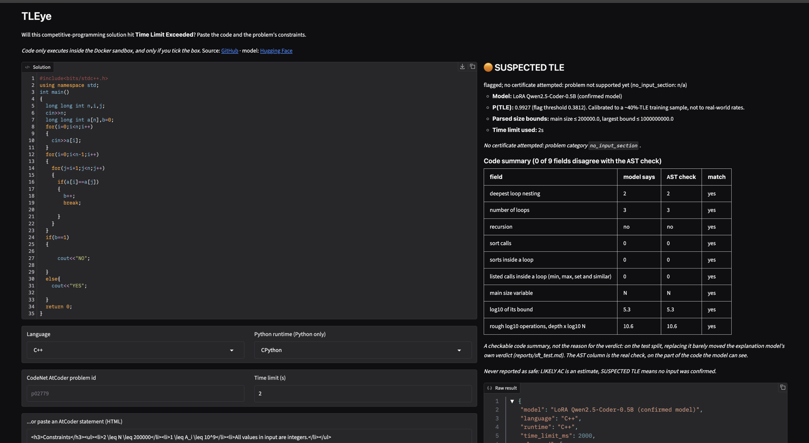
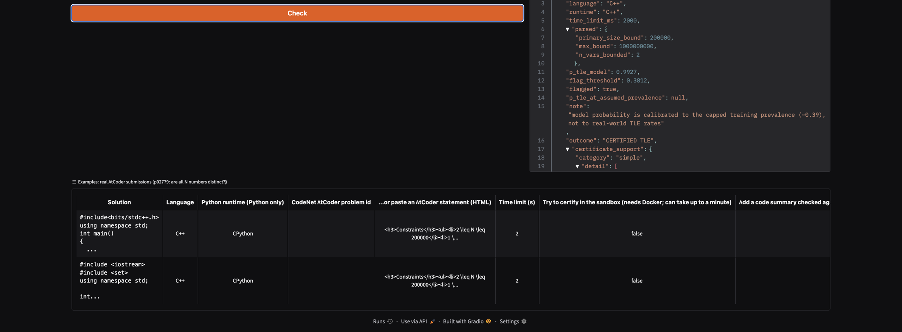
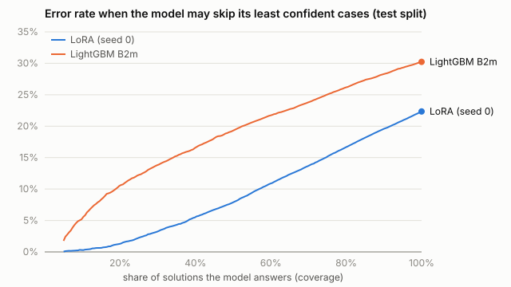

# TLEye

Predicts whether a competitive-programming solution (C++, Java or Python) will get **Time Limit Exceeded**, and tries to confirm it by
generating a worst-case input and running the program in a sandbox.

```
$ python -I -m tleye.cli check sol.cpp --problem p02779 --certify
parsed constraints : primary size <= 200000.0, max bound <= 1000000000.0
model              : LoRA Qwen2.5-Coder-0.5B (confirmed model)
P(TLE) model       : 0.9941  (flag threshold 0.3812)
OUTCOME            : CERTIFIED TLE
input 'asc.txt' used 3.95s CPU (limit 2s) in the sandbox; measured on THIS machine's arm64 container, not the contest judge
```

| outcome | meaning |
|---|---|
| **CERTIFIED TLE** | a generated input exceeded the time limit in the sandbox |
| **SUSPECTED TLE** | the model flags it, but no generated input failed; not reported as safe |
| **LIKELY AC** | the model does not flag it; an estimate, not a proof |

**Live demo:** http://3.26.12.43 (AWS, while the free credits last; the hosted version gives verdicts only, certificates run locally).



<details><summary>Options and built-in examples</summary>



</details>

## How it works

1. A parser reads the size bounds from the problem statement (e.g. `N<=2e5`).
2. A fine-tuned model (Qwen2.5-Coder-0.5B + LoRA) reads the code, the bounds and the time limit and outputs P(TLE).
   A monotone LightGBM model is the CPU fallback.
3. For flagged solutions, the certificate engine builds extreme inputs within the bounds and runs the program in Docker.
4. Optionally, a second model writes a short code summary (loop depth, sorts, N), shown next to a real AST check.

## Results

<!-- SUMMARY:START -->
| | result | compared with |
|---|---|---|
| Fine-tuned verdict model (Qwen2.5-Coder-0.5B + LoRA), test AUROC | **0.860** (3 seeds, 0.857 to 0.863) | LightGBM baseline B2m: 0.756 [0.735, 0.774]; every paired gain excludes 0 (+0.107 [+0.095, +0.120], +0.102 [+0.091, +0.115], +0.101 [+0.088, +0.115]) |
| Language never seen in training, test AUROC | C++ 0.790, Java 0.846, Python 0.775 | LightGBM, same protocol: C++ 0.707, Java 0.733, Python 0.693; calibration does NOT transfer |
| Against prompting a 7B code model (400 items) | LoRA 0.884 vs prompted 0.799 | paired gain +0.085 [+0.039, +0.128] |
| Sandbox certificates, final engine on fresh problems | 109/179 = 60.9% of true TLE solutions confirmed | 1/196 Accepted solutions wrongly certified; only 44.7% of problems are supported |
<!-- SUMMARY:END -->

Evaluated on 296 held-out AtCoder problems from IBM Project CodeNet, never seen in training. Intervals are 95% bootstrap intervals over
problems. Every number is regenerated by `make eval`; full tables are in [`reports/headline.md`](reports/headline.md) and `reports/`.

When the model may skip the cases it is least sure about, its error rate falls much faster than the LightGBM baseline's
([`reports/risk_coverage.md`](reports/risk_coverage.md)):



## Limitations

- The model ignores the time limit and reacts only weakly to the input size N.
- The code summary is accurate but does not drive the verdict; treat it as a description, not an explanation.
- Certificates are measured on our hardware (arm64 Docker on an M2), not the contest judge, and cover 44.7% of problems.
- Probabilities are calibrated to a training set with about 40% TLE, not to real-world rates (use `--prior` to adjust).
- Data is AtCoder submissions only.

## Installation

```bash
python3 -m venv .venv
.venv/bin/pip install -e ".[dev]"            # core (macOS: brew install libomp for LightGBM)
.venv/bin/pip install -e ".[train,demo]"     # optional: LoRA model, code summary, web demo
```

The LightGBM models are included. The verdict model's LoRA adapter is on Hugging Face
([LakshayKhatri231/tleye-lora-0.5b](https://huggingface.co/LakshayKhatri231/tleye-lora-0.5b)); `make weights` downloads it at the pinned
revision and verifies its checksums. Without it the CLI uses the LightGBM model. The code-summary adapter (`--explain`) is not published.

## Usage

```bash
python -I -m tleye.cli check sol.py --problem p03958             # verdict
python -I -m tleye.cli check sol.py --problem p03958 --certify   # + sandbox certificate (needs Docker)
python -I -m tleye.cli check sol.py --problem p03958 --explain   # + code summary
python -I -m tleye.cli check sol.cpp --statement stmt.html --time-limit-ms 2000
```

Options: `--model auto|lora|b2m`, `--prior 0.1`, `--json`.

Web demo (local only, http://127.0.0.1:7860):

```bash
python -I -m tleye.app
```

## API and container

```bash
make serve                      # FastAPI service on http://127.0.0.1:8000 (interactive docs at /docs)
docker build -t tleye .         # or a container; add --build-arg WITH_LORA=1 for the LoRA model
docker run -p 8000:8000 -v "$PWD/models/lora:/app/models/lora:ro" tleye
curl -s localhost:8000/check -H 'Content-Type: application/json' \
  -d '{"code": "...", "language": "C++", "statement_html": "<h3>Constraints</h3>...", "time_limit_ms": 2000}'
```

`GET /health` reports the loaded model; `POST /check` returns the same result as the CLI. Certificates are disabled in the service because
they need a Docker daemon. Measured latency: [`reports/serving.md`](reports/serving.md).
`make aws-up` / `make aws-status` / `make aws-down` run the same container on one EC2 server (`deploy/aws.sh`; set `REGION` for AWS projects tied to one region).

Operations of the live demo:
- **Continuous deployment:** the server checks GitHub every 5 minutes and deploys a new `main` commit only after all three CI jobs pass;
  a version that fails its health check is rolled back (`deploy/updater.sh`). No cloud credentials are stored on GitHub.
- **Monitoring:** a scheduled workflow runs a real prediction against the demo every 30 minutes and fails (GitHub emails the owner) if it
  is down or wrong (`.github/workflows/uptime.yml`); `/health` reports the deployed commit, uptime and request counts; CloudWatch alarms
  reboot or recover the server if AWS's status checks fail; container logs rotate.

## Reproducing

```bash
make test          # unit tests + AUROC regression gate
make lint
make sandbox-test  # needs Docker (e.g. colima start --cpu 4 --memory 3 --disk 30)
make data          # downloads CodeNet (7.8 GB) and builds the dataset
make eval          # regenerates every report from stored predictions
make verify-data   # checks the rebuilt data against the committed checksums (ci/data_manifest.json)
```

Training ran on Kaggle GPUs; the exact scripts are in `kaggle/`.

## Safety

Submission code is untrusted and is only executed inside the Docker sandbox: no network, read-only filesystem, CPU/memory/process limits,
non-root user and a hard timeout.

## Project structure

```
tleye/data         dataset extraction, cleaning, splits
tleye/constraints  statement parser
tleye/features     tree-sitter code features
tleye/models       LightGBM, LoRA and code-summary inference
tleye/certify      input generation and sandbox runner
tleye/eval         metrics and report scripts
kaggle/            GPU training and evaluation scripts
reports/           generated reports and stored predictions
tests/             tests
```

## License

Apache-2.0. Data from IBM Project CodeNet under its own terms.
