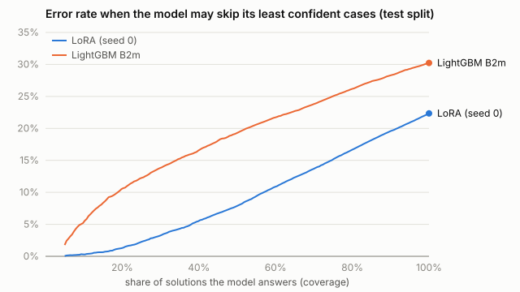

# Risk-coverage on the test split (script-generated; descriptive, nothing tuned)

42,990 test submissions, 296 problems. Predict TLE when calibrated P(TLE) >= 0.5; the model answers only its most confident share of cases (coverage) and skips the rest. Selective error = error rate on the answered cases. AURC = mean selective error over all coverages (lower is better). 95% CIs: problem-clustered bootstrap (300).

| model | AURC | error at 100% coverage | error at 80% coverage | error at 60% coverage | error at 40% coverage | error at 20% coverage |
|---|---|---|---|---|---|---|
| B2m | 0.181 [0.165, 0.203] | 0.302 | 0.262 | 0.217 | 0.166 | 0.106 |
| LoRA seed 0 | 0.090 [0.075, 0.105] | 0.223 | 0.167 | 0.109 | 0.055 | 0.013 |
| LoRA seed 1 | 0.093 [0.079, 0.108] | 0.227 | 0.173 | 0.116 | 0.058 | 0.010 |
| LoRA seed 2 | 0.094 [0.079, 0.108] | 0.230 | 0.173 | 0.112 | 0.060 | 0.012 |

Paired AURC difference, LoRA seed 0 minus B2m: -0.091 [-0.104, -0.081] (negative = LoRA makes fewer errors).

Reading it: at 100% coverage the error is the plain error rate at P(TLE) >= 0.5. Abstaining lowers it, which is what SUSPECTED TLE and an uncertain LIKELY AC are for. The probabilities are calibrated to a sample with about 40% TLE, so the 0.5 rule is not tuned for real-world rates.

